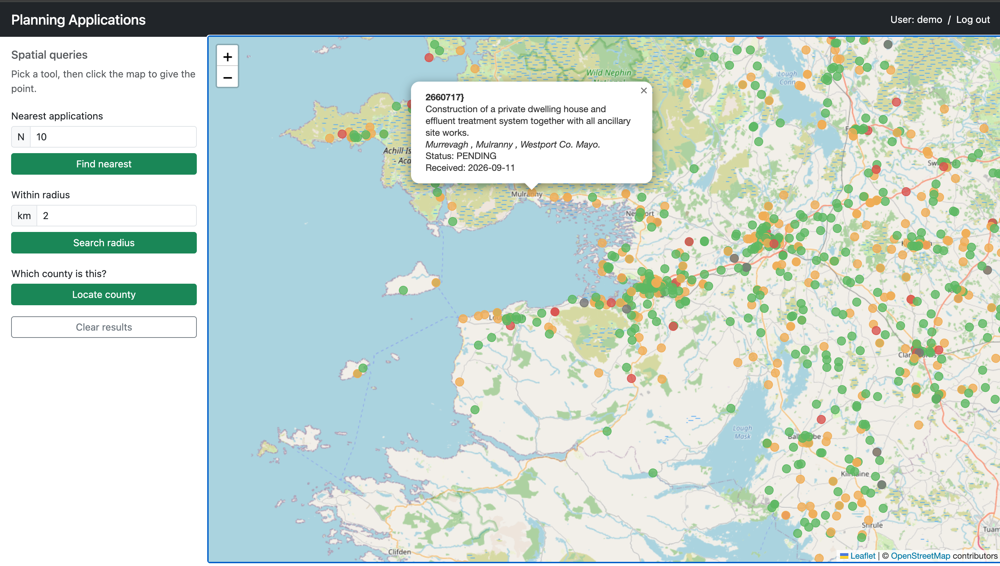
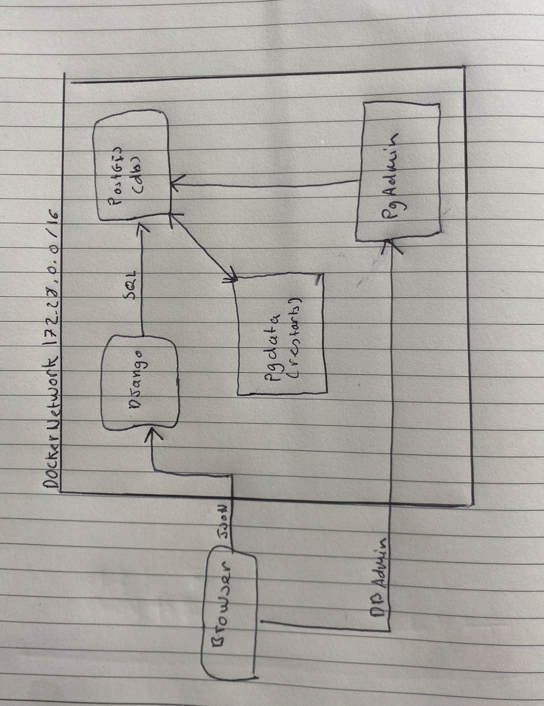

## Author: Matthew Hogan
## Title: Map of Planning Applications
## Description: Shows planning applications on a map in county Mayo with description of application and answers location questions such as the number of applications, applications within a certain distance and what county is this?

## Picture of map 

## Features 
    - Coloured pins with pop up description
    - 5 spatial queries:
        1. Nearest applications to a point you click.
        2. Applications within a radius (X km) of a point you click.
        3. Which county a point you click is in.
        4. Applications near a route, within X m of a line.
        5. Applications inside an area.

## Technology Stack
    -Database: PostgreSQL and PostGIS 
    -DB admin: pgAdmin 4 
    -Backend: Python 3
        -Django and GeoDjango: web framework with MVC
        -Django REST Framework: Rest API
        -djangorestframework-gis: Geo json from serialized models
        -psycopg: PostgreSQL driver
        -GDAL, GEOS, PROJ: system libraries for geometry operations, coordinate transform for GEODjango
    -Frontend: Bootstrap for responsive layout and buttons
        -Leaflet: Interactive map, markers, pop ups
        -OpenStreetMap: tiles, Base map
    -Deployment: Docker and Docker compose separate container with custom bridge network 172.28.0.0/16
    -Data pipeline: Source of the planning applications and county boundaries GeoJSON, outSR=4326

## Architecture 
    3 containers on one docker network for security and isolation. Only Django and pgAdmin publish port, postGIS reachable inside the network. Browser talks to Django and djanho queries postGIS.
    Diagram of System: 

 ## Set up for Local Deployment 
    1. Clone the repo:
            git clone https://github.com/matthewhogan2/lbs-planning-mapper
            cd lbs-planning-mapper

    2. Create Environment File:
            cp .env.example .env
        Then open .env and change every 'change-me' value (secret key, database password, pgAdmin password).
    
    3. Build and start the containers:
            docker compose up -d --build
        This start the 3 containers lbs_db, lbs_web and lbs_pgadmin
        Check container are running correctly using 'docker compose ps'
    
    4. Download the open data:
            sh scripts/download_data.sh
        Downloads the county boundaries and about 1,000 recent Mayo planning applications into `backend/data/`
    
    5. Load the data into PostGIS:
            docker compose exec web python manage.py load_counties data/counties.geojson
            docker compose exec web python manage.py load_applications data/mayo_applications.geojson
        Expected Result: `Loaded 26 counties` and `Loaded 1000 applications`
    
    6.  Create a user:
            docker compose exec web python manage.py createsuperuser
    
    7. Open the app:
            Map =           http://localhost:8000
            API =           http://localhost:8000/api/
            Django Admin =  http://localhost:8000/admin
            pgAdmin =       http://localhost:5050 log in from .env info

    8. To Stop Run:
            docker compose down      # stops containers, keeps the data
            docker compose down -v   # also deletes the database volume

## Test login 
    user: demo
    password: mapper2026

## User guide 
    1. Open http://localhost:8000.
    2. Each dot is a planning application, coloured by status:
            green = granted
            amber = pending
            red = refused
            grey = withdrawn
    3. click dot to see its reference, description, address, status and date received
    4. Can zoom in and put with +/-
    5. Use spatial queries in the side bar to filter applications by radius, Nearest, and what county? 
    click clear to reset
    7. log in and Log out in the top right of navbar.
    8. Queries 4 and 5 (Routes and areas) are private to logged in users who create them
    9. To create route log in then open http://localhost:8000/api/routes/ 
        at the bottome of the page choose raw data paste GEOJson feature and click post.
            {"type": "Feature",
            "geometry": {"type": "LineString", "coordinates": [[-9.53, 53.80], [-9.50, 53.81], [-9.47, 53.82]]},
            "properties": {"name": "Westport greenway extension"}}
        Note the id in the response.
    10. Area works the same using http://localhost:8000/api/areas/ using a polygon the first and last point 
        must match then http://localhost:8000/api/areas/<id>/applications/

## API 
Method  |  Endpoint                       |    what it does           | Log in 
GET | '/applications'                     | Filter app                | no  
POST, PATCH, DELETE | /applications/<id>/ | Create, edit, delete      | yes 
GET | /applications/nearest/?lat=&lng=&n=10 | Nearest N application    | no
GET | /applications/within/?lat=&lng=&km=2  | Applications within X km | no 
GET | /counties/locate/?lat=&lng=           | County a point is in     |no 
GET + POST | /routes/                       | your route               |yes
GET | /routes/<id>/nearby/?m=500            | Applications near route  |yes
GET + POST | /areas/                        | your area                |yes
GET | /areas/<id>/applications/             | Application in an area   |yes

## Errors:
400 = bad input
403 = not logged in 
404 = not found

## Database schema 
Planning applications:
id          | int, pk 
refrence    | text (unique)
description | text
address     | text
app_type    | residential, commercial, agricultural, other
status      | pending, withdrawn, granted , refused, other
received_date| date
decision_date| date
location    | point

County:
id      | int, pk 
name    | text (unique) 
boundary| multi polygon

Route:
id      | int, pk
name    | text 
path    | LineString 
owner   | fk user 

AreaOfInterest:
id   | int, pk 
name | text 
area | polygon
owner| fk user

## Data sources 
Applications: National Planning Application Database, Department of Housing, Local Government and Heritage
County Boundaries: National Statutory Boundaries 2024
Map Tiles: OpenStreetMap 

## Known issues and limitations 
-Data is limited to the 1,000 most recent Mayo County Council applications, to keep the map fast.
-Application status is inferred from the councils free-text decision, so unusual wording may be misclassified.
-Routes and areas (queries 4 and 5) can only be created through the API, there is no drawing tool on the map yet.
-Applications cant be added or edited from the map, only through the API.
-Any logged in user can edit any application, a production version would restrict this to admins.
-Local deployment only, no HTTPS, no Nginx reverse proxy, and Django development server is used.

## AI use
This project was built with the help of AI

AI helped with:
-Explaining concepts and reviewing my code
-Generating API views, serializers, data loaders and download script
-Debugging: county geometry errors, the OpenStreetMap tile blocking, Docker issues, model issues

